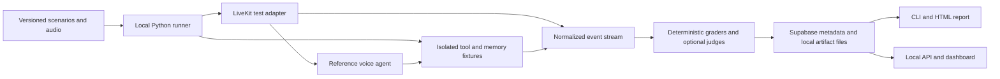

# Voice agent evaluation and debugging MVP

Date: 2026-10-15. Working name: TurnLab; name availability has not been checked.

## Decision and constraints

The user selected a voice-agent evaluation and debugging toolkit, targeting global or remote AI Engineer opportunities. Build a useful local product in 4–6 weeks. Accepted choices: LiveKit Agents with a local LiveKit media server, local application execution with optional Groq LLM inference, Deepgram STT/TTS, and hosted Supabase for database persistence. The application is not hosted; selected database records are stored in the cloud. No paid subscriptions or final model/voice defaults have been selected. Choose the remaining services individually before integration.

Implemented: fixture grading, bounded tool recovery, a LiveKit reference voice adapter, React run inspector, cross-process event feed, evidence summaries, optional Groq hypotheses, executable reference and model text cases, memory lifecycle checks, run comparisons, review worksheets, and English transcript scoring. Supabase metadata writes/read-back and a real Groq tool evaluation pass. A full spoken conversation, recorded WAV adapter acceptance, audio latency measurements, and external pilot feedback remain pending. See [regression and pilot guide](regression-and-pilot.md), [build phases](build-phases.md), [dashboard guide](dashboard.md), [voice quickstart](voice-quickstart.md), and [development instructions](development.md).

## Problem and first customer

Target a Python developer or small team building LiveKit voice agents. They need to detect failures during calls, keep conversations moving through tested recovery policies, and understand what happened afterward. After changing a prompt, model, turn detector, tool, or memory policy, they also need regression evidence without manually listening to every conversation.

The user accepted live monitoring, predefined safe recovery, and deeper post-call analysis as the product scope. The first workflow is: observe an instrumented call, detect an incident, apply only an allowed recovery, explain the evidence afterward, and turn a reviewed failure into a regression test. Confirmed errors and hypothesized causes must remain distinct. See [live monitoring scope](live-monitoring.md).

Examples worth catching:

- A caller corrects a date, but the booking tool receives the original date.
- A tool times out after committing a booking; a retry creates a duplicate.
- The agent speaks over a caller spelling an identifier.
- A returning caller receives stale facts from a summary instead of current job data.
- One user's retrieved memory appears in another user's session.

These are proposed use cases. Willingness to adopt or pay remains unvalidated.

## Market reality and proposed position

[LiveKit already provides unit tests, simulations, and observability](https://docs.livekit.io/testing/). [Hamming](https://hamming.ai/), [Coval](https://www.coval.dev/voice-ai-testing), and [Cekura](https://www.cekura.ai/blogs/voice-observability) also address voice testing or debugging. Testing, timelines, and regression tests alone are not novel features.

Our proposed position is a narrow, inspectable, local-first developer workflow for LiveKit: versioned scenario files, fixture-controlled tool failures and cross-session memory, transparent grading, and a report that works without a hosted control plane. This is a positioning hypothesis, not evidence that competitors cannot provide those capabilities.

Use LiveKit's test helpers where appropriate. Its documented Agent Simulations require LiveKit Cloud, so do not use that service as the dependency for a fully local runner. See [simulation requirements](https://docs.livekit.io/testing/simulations/).

## Alternatives considered

| Idea | Concrete buyer problem | Fit with existing experience | Main difficulty | Decision |
| --- | --- | --- | --- | --- |
| Appliance-repair voice desk | Capture requests, book visits, preserve repeat-caller context | Strong tools and memory demo | Requires access to operators and scheduling workflows | Alternative |
| Voice IT helpdesk | Gather incident context and route or resolve routine requests | Strong RAG and backend demo | Enterprise integrations and permissions | Alternative |
| Voice regression toolkit | Find and explain regressions before an agent update | Direct connection to speech-provider benchmarking and backend experience | Crowded market; credible audio measurement is difficult | Selected by user |

## Product workflow

During a live call, capture relevant events, detect configured failures, and show incidents in the dashboard. Recovery is limited to tested policies; background diagnosis must not block audio. After the call, explain evidence, recovery outcomes, and proposed fixes. No automatic code or prompt edits occur during calls.

The regression workflow remains:

1. Register a local test agent through a small Python adapter. No arbitrary remote endpoint execution in v1.
2. Select a checked-in scenario suite and a named configuration snapshot.
3. Run deterministic checks, text conversations, or audio scenarios. Clearly label the mode.
4. Inspect a run timeline with transcripts, audio segments, tool arguments/results, memory reads/writes, and assertion evidence.
5. Compare a candidate with a compatible baseline. Filter regressions by scenario, configuration, and failure category.
6. Export JSON and a standalone HTML report. A failing required assertion returns a nonzero CLI exit code.
7. Save a reviewed failure as a new scenario; editing and redaction remain visible to the developer.

The local dashboard is the primary live monitoring interface; the CLI runs repeatable regression suites. Both consume the same normalized evidence and grader outputs.

## Evaluation modes and honest coverage

| Mode | Runs | Valid evidence | Does not establish |
| --- | --- | --- | --- |
| Fixture checks | Seeded event streams, tool state, memory state, validators | Grader correctness, duplicate-effect detection, trace handling | Real model quality or speech latency |
| Text conversation | Agent logic and tools with scripted user text | Arguments, task outcome, context behavior, grounded responses | STT, TTS, interruption, or audio timing quality |
| Recorded audio | Consented or licensed audio fed through the speech pipeline | Transcription, entity preservation, pipeline behavior on that audio | General accent robustness or telephone-network performance |
| Interactive duplex audio | Local simulated caller publishes audio and records received agent output | Caller-observed response delay, overlap, interruption stop behavior | PSTN/SIP reliability or production scale |

The revised four-week target is an instrumented local-call demo with tool-error/timeout detection and post-call reports, backed by fixture and text checks. Weeks five and six prioritize bounded recovery and repeated-failure tests. Recorded-audio scoring is added only as time permits; automated duplex benchmarking is deferred if needed. Show unavailable audio metrics explicitly instead of substituting text tests or tool durations.

## Features with a clear engineering purpose

### Scenario contracts and grading

- Versioned YAML/JSON scenarios validated with typed schemas. Include suite, language, user turns/audio files, fixtures, expected actions, state assertions, and optional judge rubrics.
- Exact assertions for tool names, arguments, call order when necessary, committed side effects, and prohibited memory access. Check final state as well as transcript claims.
- Optional LLM judges for semantic helpfulness or paraphrased grounding. Store judge prompt/model/version, evidence, and uncertainty. Judge failures are separate from application failures.
- Human review for ambiguous failures. Never let an LLM verdict override a failed deterministic safety or state assertion.
- Required scenarios, optional scenarios, and per-mode coverage in every report. Missing signals produce `not_measured`, never a fabricated zero or pass.

### Tools and fault injection

The reference agent gets a small local service-ticket fixture: look up a ticket, check availability, book a slot, and request human review. It exists to exercise evaluation features; it is not a second commercial product.

Inject latency, schema errors, transient failures, and a timeout after a committed write. Record the attempted call separately from the actual side effect. Run against isolated local fixture data; never execute production bookings, emails, or payments during tests.

MCP is a proposed optional adapter: expose the same fixture tools through one local MCP server and verify that tracing and contracts still work. Native Python tools come first. Do not add a general filesystem or shell tool just to demonstrate MCP. [LiveKit documents both MCP and function tools](https://docs.livekit.io/agents/logic/tools/mcp/).

### Memory and context engineering

Memory is a first-class test surface in the reference agent and runner, not an unbounded collection of past transcripts:

- Working memory: bounded recent turns and a structured task state.
- Durable memory: explicit, attributed customer preferences or case facts in the selected persistence backend (hosted Supabase), scoped by tenant and user. Offline fixture tests use isolated in-memory records.
- Episodic context: compact summaries with source turn IDs and timestamps.
- Knowledge retrieval: a small, versioned policy corpus with source attribution. Use retrieval only when a scenario needs it.

Test recall across two linked sessions, correction of an outdated preference, expiration, deletion, provenance, context truncation, and user isolation. Current transactional data wins over old summaries. A first implementation can use structured records and text search; semantic retrieval is a separate decision requiring a measurable benefit.

The diagnostic assistant, if added, retrieves evidence only from the selected run. It can suggest hypotheses with event links; it cannot silently change prompts, label an inferred root cause as proven, or rewrite golden tests.

### Speech behavior and current techniques

Evaluate streaming STT/TTS, endpointing, interruptions versus backchannels, and preemptive generation through configuration comparisons when supported by the selected SDK/provider. Preemptive generation can spend tokens on discarded work; record that trade-off. See [LiveKit turn tuning](https://docs.livekit.io/agents/logic/turns/tuning/).

A later speech-to-speech adapter should use the same scenarios, outcome assertions, and caller-side timing, making a fair comparison possible. It is not a requirement for the first release. Model names and API support must be checked when each provider is selected.

## Metric definitions

| Metric | Definition and evidence |
| --- | --- |
| Task success | All required end-state assertions pass; report numerator and denominator by mode |
| Tool correctness | Schema/name/arguments match the scenario contract; report attempts separately from successful effects |
| Duplicate effects | Extra committed fixture mutations for the same logical operation, rather than repeated tool calls alone |
| Memory quality | Expected sourced facts recalled; stale facts corrected; prohibited reads/writes absent |
| WER | (Substitutions + deletions + insertions) / reference words with a declared language-specific normalization; exclude empty references from this denominator |
| Entity accuracy | Exact or explicitly normalized match for annotated dates, names, identifiers, and amounts |
| Caller response delay | First received agent speech onset minus annotated caller speech end, measured on the simulated caller's clock; report signed values and overlap separately |
| Interruption stop delay | Agent speech end at the receiver minus injected interruption onset on that receiver's timeline; requires actual audio measurements |
| Component timings | STT, model, tools, and TTS spans; do not present these as caller-observed delay |
| Cost | Observed usage times a dated rate card; report unknown usage as unknown and local compute separately |

Store UTC timestamps for audit and monotonic timestamps for elapsed time. Do not subtract unsynchronized clocks from separate processes. Preserve sample rate, audio offsets, config hash, dependency versions, prompt version, model ID, language, and hardware metadata. Mark detector-derived speech boundaries as estimates, with manual review for questionable cases.

Baseline comparisons use identical scenarios and compatible hardware/configurations. Model outputs remain stochastic even with a fixed seed. Use repeated paired runs where affordable; report sample counts and distributions rather than declaring a universal winner from one conversation.

## MVP architecture



Proposed repository layout:

```text
src/turnlab/
  scenarios/       # schemas, loaders, validation
  runner/          # lifecycle, timeouts, cancellation, bounded concurrency
  adapters/        # LiveKit integration first
  instrumentation/# normalized events and correlation
  fixtures/        # tools, memory, failure injection
  graders/         # objective checks, audio metrics, optional judges
  storage/         # run metadata and artifact references
  reports/         # JSON, JUnit, HTML exports
  api/             # dashboard API, added after CLI
examples/reference_agent/
scenarios/
tests/
web/               # proposed dashboard
docs/
```

The existing worker stays executable while a configured reference agent is introduced. Choose compatible SDK versions, add the missing turn-detector dependency explicitly, and lock the tested environment. Do not silently assume the unpinned old imports still match the latest SDK.

## Service choices in order

Rows 1–5 and 7 have accepted frameworks/providers: local LiveKit, optional Groq LLM inference, Deepgram STT/TTS, hosted Supabase, and FastAPI plus React/TypeScript. Model/voice defaults and remaining services are proposals. Do not subscribe to paid plans without selecting them explicitly.

| Order | Decision | Initial recommendation | Alternative / trade-off |
| --- | --- | --- | --- |
| 1 | Voice framework and transport — accepted | Retain LiveKit Agents; console first, local LiveKit server for browser/audio runs | Broader framework support later; adapting multiple SDKs now increases scope |
| 2 | LLM execution — approach and first provider accepted | Local application with optional Groq LLM; offline fixture suite remains usable without an API key | Final model pending; compare tool-calling quality and latency on 10 fixed cases |
| 3 | STT — provider accepted | Deepgram through its direct LiveKit plugin; Nova-3 is a proposed initial streaming baseline | Flux can be evaluated separately because its native turn detection changes the test configuration |
| 4 | TTS — provider accepted | Deepgram through its direct LiveKit plugin; Aura-2 is a proposed baseline | Voice and language defaults remain configurable and must match supported languages |
| 5 | Run storage — accepted | Hosted Supabase PostgreSQL for run metadata, results, and persistent records; audio/JSONL trace files stay on local disk | Database access needs network connectivity; fixture-only tests remain offline |
| 6 | Agent memory | Structured Supabase records and explicit context budgets; isolated in-memory fixtures for offline tests | Add semantic retrieval only after recall tests show a need |
| 7 | Dashboard — accepted | FastAPI plus React/TypeScript; local only | Standalone HTML is the four-week fallback |
| 8 | Judges and diagnostics | Objective checks first; optional provider-backed semantic judge | No mandatory second paid model or autonomous debugging agent |
| 9 | MCP / durable workflows | Small MCP fixture adapter if the core suite is complete | LangGraph only if resumable diagnostic/human-review workflows become necessary |

[LiveKit supports running its media server locally](https://docs.livekit.io/transport/self-hosting/local/). Local hosting and local inference are separate decisions. The default runner must not upload artifacts. Optional provider use needs explicit configuration and a visible mode label. Keep Cloud-only enhanced noise cancellation disabled in the local profile.

Hardware inspected on 2026-10-15: approximately 7.4 GiB reported physical RAM and an NVIDIA GeForce GTX 1650 with 4096 MiB VRAM. No inference benchmark has been run. This is a tight budget for a model, STT, TTS, browser, and services together. Start with fixture runs and one live scenario at a time; benchmark a small quantized model before promising interactive local performance. Do not make a large model, multiple containers, or parallel audio execution a baseline requirement. Model/runtime choice remains open.

The user subsequently chose optional cloud LLM inference instead of requiring local models, and selected Groq as the first LLM provider to evaluate, reusing the existing integration. `openai/gpt-oss-20b` remains a model candidate rather than an accepted default. [Groq's model page](https://console.groq.com/docs/model/openai/gpt-oss-20b) lists tool use and structured-output capabilities. Its [tool support table](https://console.groq.com/docs/tool-use/overview) lists no parallel tool support for this model, so keep the initial tool flow sequential and label that limitation. Gemini remains a possible future comparison provider, not the selected first integration. No new model configuration or benchmark has been executed. Cloud inference sends selected prompts, context, and tool results to that provider; local artifact storage does not prevent that transmission. No cloud STT/TTS selection is implied by this LLM choice.

The user selected Deepgram for both STT and TTS. Use the direct [LiveKit Deepgram STT plugin](https://docs.livekit.io/agents/models/stt/deepgram/) and [TTS plugin](https://docs.livekit.io/agents/models/tts/deepgram/) with `DEEPGRAM_API_KEY`, rather than making LiveKit Cloud Inference a requirement. Nova-3 streaming STT and Aura-2 TTS are proposed baselines, not benchmark winners or accepted model defaults. Nova-3 keeps STT and turn detection separable; evaluate Flux separately with its model-native turn detection. Verify TTS language/voice coverage separately from STT coverage before adding multilingual scenarios. Audio and synthesis text are sent to Deepgram during live speech runs. Groq Whisper and ElevenLabs are no longer the selected speech providers; migrate the reference worker during implementation. No credentials, subscriptions, or live API calls have been created by this selection.

The user selected hosted Supabase with the application running locally, superseding the SQLite proposal. Persist run metadata, scenario results, and durable memory records in Supabase PostgreSQL. Keep audio and detailed JSONL trace artifacts on local disk; database rows contain artifact identifiers/checksums rather than uploading those files. Auth, Storage, and vector retrieval remain optional later capabilities. Provide isolated in-memory fixture repositories so deterministic tests need no network or credentials. Batch database writes outside audio-critical callbacks and retain local partial artifacts on network failure; surface synchronization errors explicitly. Database credentials remain in backend configuration, not frontend code. Use scoped test data and server-enforced access boundaries for multi-user/tenant tests. No Supabase project has been created, connected, or modified.

## Four to six week delivery plan

Planning estimate: one developer, roughly 15–20 focused hours/week. Adjust after the first adapter spike; this is not a guaranteed schedule.

| Week | Deliverable | Exit evidence |
| --- | --- | --- |
| 1 | Fixture runner foundation, event/incident contracts, detection fixtures | One clean and one deliberately broken tool scenario produce inspectable evidence |
| 2 | LiveKit instrumentation, tool fault injection, deterministic incident detection | A local live call emits a correlated tool failure/timeout without blocking audio |
| 3 | Supabase metadata integration, local dashboard incident stream | Active session, incidents, evidence, and incomplete telemetry are visible |
| 4 | Post-call incident reports, reviewed diagnosis and fix suggestions | Confirmed failures and hypotheses are distinct; second developer reproduces the demo |
| 5 | Bounded recovery policies and regression scenarios | Safe read retry succeeds; uncertain committed write is not blindly repeated |
| 6 | Failure handling, memory isolation cases, external developer feedback | Recovery limits, cancellations, telemetry gaps, and unavailable services tested |

If time is tight, cut MCP, extra providers, rich dashboard features, and automatic audio-quality benchmarks before cutting reliable incident detection, evidence capture, or recovery boundaries. Keep the live-call demo honest about which signals are measured. Post-call analysis can initially use structured evidence templates before optional LLM enrichment.

## Acceptance evidence and benchmark plan

- Start with 20 reviewed scenarios: 5 conversation/tool flows, 5 tool failures/side effects, 5 memory/context cases, and 5 audio/turn cases. Record applicable modes for each.
- Keep independent known-good/known-bad event fixtures to test graders; do not use only assertions that mirror implementation.
- Add at least three consented speakers for the initial audio set; label languages and conditions. This is a small benchmark, not evidence of universal accent coverage.
- Include human-annotated speech boundaries for timing checks. If an automatic detector disagrees, display both and allow review.
- Demonstrate at least three intentionally introduced regressions, the trace evidence, and successful reruns after actual fixes.
- Verify run cancellation, crashed-agent cleanup, partial artifacts, malformed events, missing references, invalid schemas, and recovery after restart.
- Ensure the default offline fixture suite has no API requirement. Make paid/live-provider test runs opt-in. A local CI-compatible command is sufficient before choosing any hosted CI service.
- Publish sample sizes, selected hardware, test mode, repetitions, rates, and unknown metrics with every benchmark. Targets become measured outcomes only after execution.

## Validation and business path

During weeks 1–2, ask five voice-agent developers about their last difficult regression, current tools, reproduction time, and whether local artifact handling matters. Do not assume a market gap because a feature is buildable.

Success for the pilot: at least two external developers can run a suite against their own development agent and identify a useful failure. This is a target, not current traction. If they prefer existing tooling, investigate integration/export rather than recreating an entire platform.

A potential later business is an open local runner with paid team collaboration, private artifact handling, and shared regression baselines. Pricing, hosted storage, production call ingestion, and enterprise claims remain outside this MVP.

## Resume and interview evidence

The resume reports experience in voice pipelines, provider benchmarking, memory/tools, Python backends, and document retrieval. Treat those as user-reported experience; this repository does not independently verify the listed metrics.

The additional portfolio evidence should be a public design, reproducible test suite, failure-to-fix demo, and measured results. Suggested future bullet structure:

> Built a local voice-agent regression toolkit with [N] reviewed scenarios, audio/tool/memory trace correlation, and baseline comparison; detected [N] seeded regressions across [N] repeated runs and measured [named metrics] on [hardware and mode].

Fill placeholders only after measurement. Do not claim production scale, customer adoption, uptime, or time savings from local fixtures. Keep private employer recordings/data and the user's resume out of committed example datasets.

## Current repository concerns

The tracked `.env` requires attention before publication: stop tracking live secrets and rotate any real credentials exposed in history. Do not display values in diagnostics. Add safe example configuration, explicit dependency versions, a local profile, and a provider support matrix during the implementation foundation step.

See [proposed architecture decisions](architecture/adr-001-local-evaluation-toolkit.md).
