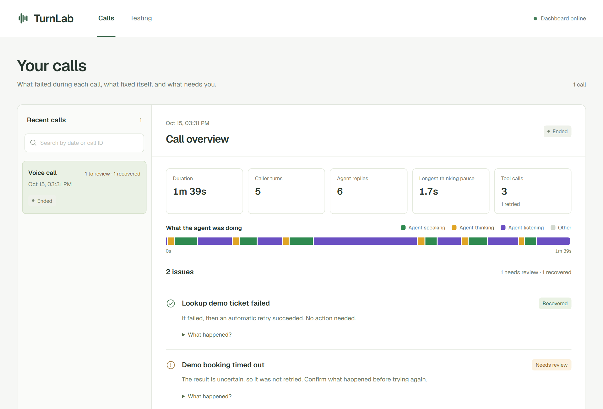
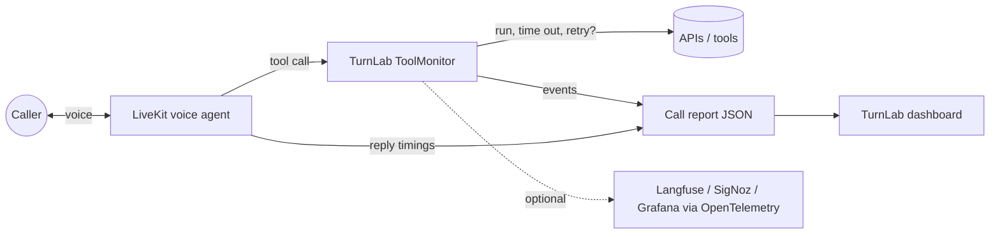

# TurnLab

**A monitoring and safety layer for AI voice agents.** It watches every tool call your agent makes during a live call, retries the failures that are safe to retry, stops the ones that aren't, and shows what happened in a dashboard.

Built with Python, LiveKit Agents, FastAPI, React + TypeScript and OpenTelemetry.



---

## The problem

Voice agents (AI receptionists, booking bots, support lines) do real work during a call. They look up orders, book appointments and issue refunds by calling tools and APIs. Those calls fail all the time: timeouts, flaky services, rate limits.

The usual fix is "just retry", and that's dangerous:

- If a **lookup** times out, retrying is harmless.
- If a **booking** times out, the booking may already have gone through. Retrying can **book the customer twice** or **charge them twice**.

Meanwhile the developer usually can't see what happened. Was the caller kept waiting? Was the slowness in the AI model or the voice? Did the agent silently fail? Most teams only find out from an angry customer.

## The solution

TurnLab sits between the agent and its tools and makes one decision for every failure: **is it safe to try again?**

| Tool type | Example | What TurnLab does on failure |
| --- | --- | --- |
| Read-only | Look up a ticket | Retries automatically, then reports whether it recovered |
| Safe write (has an idempotency key) | Create booking with a unique ID | Retries, because the server ignores duplicates |
| Unsafe write | Issue a refund | **Never retries.** Marks it "Needs review" so a human checks first |

Everything that happens shows up on a local dashboard in plain language. "Book visit timed out: needs review", for example, rather than a stack trace.



## What you can see

- **Every call as a report**: duration, caller turns, agent replies, tool calls and retries.
- **Issue cards**: what failed, whether it recovered, and what to check next.
- **Reply wait chart**: how long the caller waited for each reply, and whether the delay came from the AI model or the text-to-speech.
- **Agent activity strip**: when the agent was speaking, thinking or listening.
- **Interruptions**: when the caller talked over the agent.
- **Crash detection**: a call whose reports stop arriving is marked *Updates stopped*.
- **Testing tools**: a failure demo, before/after regression checks, and speech-to-text accuracy scoring.
- **Optional AI explanations**: sends only incident metadata (no transcripts or audio) to an LLM and returns likely causes.

**Privacy by default.** Transcripts and audio are never saved. Reports stay on your machine as JSON files.

## Try it in 5 minutes (no API keys needed)

Requirements: Windows PowerShell, Python 3.11+, Node.js 22+.

```powershell
python -m venv .venv
.\.venv\Scripts\python.exe -m pip install -e ".[api,test]"
Set-Location web; npm.cmd ci; npm.cmd run build; Set-Location ..
.\scripts\start-local.ps1
```

Open http://127.0.0.1:8000, go to **Testing**, and click **Run demo**. You'll see the core idea in action:

- **Lookup ticket failed → Recovered.** A read failed once, and the automatic retry worked.
- **Book visit timed out → Needs review.** The booking may have gone through, so TurnLab did **not** retry it.

## Monitor a real voice call

You'll need a local LiveKit server (`livekit-server.exe --dev`) plus Groq and Deepgram API keys.

```powershell
.\.venv\Scripts\python.exe -m pip install -e ".[api,voice,test]"
Copy-Item .env.example .env        # then add GROQ_API_KEY and DEEPGRAM_API_KEY
.\.venv\Scripts\python.exe agent.py console
```

Talk to the agent through your microphone. The call appears on the dashboard within about a second. To trigger failures on purpose, set `$env:TURNLAB_DEMO_FAULTS = "true"` first, then ask *"What is the status of ticket DEMO-001?"*

## Add it to your own agent

Wrap each tool and declare whether it is safe to retry:

```python
from turnlab.monitoring import ReplaySafety, ToolPolicy

LOOKUP = ToolPolicy("lookup_order", ReplaySafety.READ_ONLY, timeout_seconds=3, max_retries=1)
REFUND = ToolPolicy("issue_refund")  # default: unsafe, never retried

@function_tool
async def lookup_order(self, order_id: str) -> dict:
    outcome = await self.monitor.execute(LOOKUP, lambda ctx: orders.get(order_id))
    return asdict(outcome)  # succeeded | failed | uncertain
```

The full example is in [src/turnlab/voice.py](src/turnlab/voice.py).

Already using an observability platform? Set `TURNLAB_OTEL_ENDPOINT` and TurnLab forwards LiveKit's OpenTelemetry traces, with its retry decisions attached, to Langfuse, SigNoz, Grafana or any OTLP backend. Conversation text is stripped unless you opt in.

## How it's built

| Part | Tech | Where |
| --- | --- | --- |
| Voice agent | LiveKit Agents, Deepgram (speech), Groq (LLM) | [agent.py](agent.py), [src/turnlab/voice.py](src/turnlab/voice.py) |
| Retry and safety engine | Python asyncio | [src/turnlab/monitoring.py](src/turnlab/monitoring.py) |
| Call analysis | Python | [src/turnlab/analysis.py](src/turnlab/analysis.py) |
| Tracing export | OpenTelemetry (OTLP/HTTP) | [src/turnlab/telemetry.py](src/turnlab/telemetry.py) |
| API | FastAPI | [src/turnlab/api.py](src/turnlab/api.py) |
| Dashboard | React, TypeScript, Vite | [web/src](web/src) |
| Tests | unittest, 68 tests, GitHub Actions CI | [tests](tests) |

Key design decisions:

- **Unsafe by default.** A tool is never retried unless the developer marks it read-only, or marks it as a safe write and passes an idempotency key.
- **"Uncertain" is its own outcome.** A timed-out write isn't "failed", because it might have succeeded. The dashboard asks a human to check instead of guessing.
- **Local first.** No account, no cloud and no keys needed to try it. Cloud sync (Supabase) and OpenTelemetry export are opt-in.

Run the tests:

```powershell
.\.venv\Scripts\python.exe -m unittest discover -s tests
```

## More detail

[Dashboard](docs/dashboard.md) · [Voice setup](docs/voice-quickstart.md) · [Regression testing](docs/regression-and-pilot.md) · [API and development](docs/development.md) · [Monitoring design](docs/live-monitoring.md)
